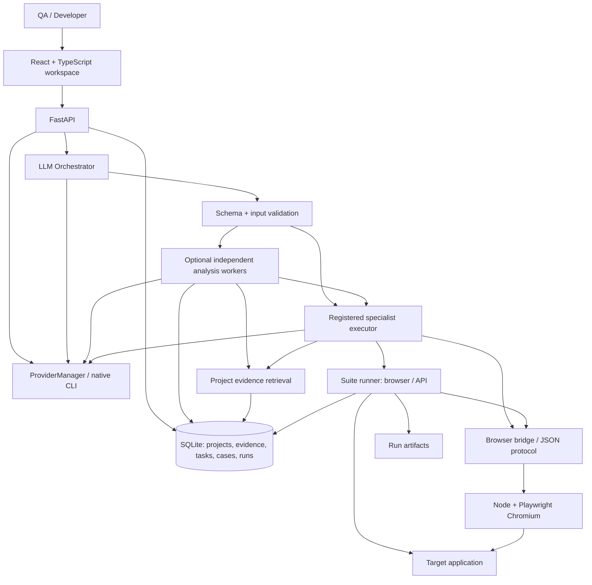
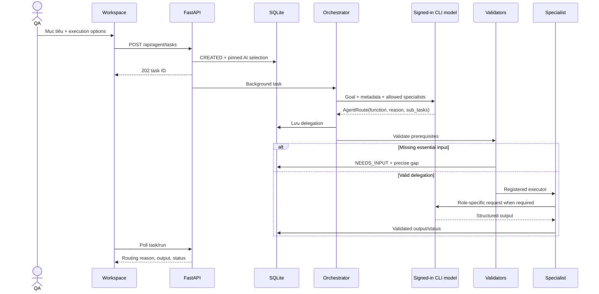

# TestAgent — Thiết kế hệ thống hiện tại

Phiên bản tham chiếu: mã nguồn trong repository, cập nhật 05/10/2026. Tài liệu mô tả khả năng đã triển khai; hướng mở rộng ở phần cuối chưa phải hành vi hiện có.

[README](./README.md) hướng dẫn vận hành. [SRS](./SRS.md) đặc tả yêu cầu/điều kiện chạy. [TEST_BRIEF.template.md](./TEST_BRIEF.template.md) giúp chuẩn bị ngữ cảnh của ứng dụng cần test.

## 1. Mục tiêu và quyết định kiến trúc

TestAgent chuyển mục tiêu kiểm thử thành sản phẩm có thể review và kết quả có thể kiểm chứng. AI hiểu mục tiêu, chọn chuyên trách, đề xuất cases hoặc browser actions. Mã ứng dụng xác thực schema, dữ liệu, quyền thực thi và ghi kết quả runner.

| Quyết định | Lý do | Hệ quả |
|---|---|---|
| Routing do LLM | Hiểu deliverable/ngữ cảnh thay vì từ khóa | Cần provider/account; sai JSON/ID báo lỗi, không keyword fallback |
| Registry allowlist | Giới hạn chức năng và file prompt | AI chỉ chọn chức năng có implementation |
| Typed DSL thay cho generated code execution | Validate capabilities trước khi chạy | Có giới hạn action/assertion; unit code chỉ review |
| Python backend; TypeScript browser engine | Tách API/context khỏi Playwright semantics | Schema/protocol/runtime/compiler phải đồng bộ |
| SQLite và in-process BackgroundTasks | Vận hành local đơn giản | Chưa có durable queue/resume/distributed workers |
| Tài liệu input tùy chọn | URL/goal có thể đủ cho smoke/discovery | Unknown business rules cần được phân biệt rõ |
| Một agent chính và 0–3 sub-agent phân tích | Fan-out các phần độc lập; giữ chi phí nhỏ cho mục tiêu đơn giản | Chưa có dependency graph hoặc pipeline generate/run/repair tự động |

Environment production là thuộc tính của **ứng dụng được test**, không phải cơ chế deploy TestAgent lên server production.

## 2. Thành phần và luồng chính

Mũi tên mô tả lời gọi/dữ liệu. Các worker phân tích độc lập có thể chạy song song; specialist chính đợi bàn giao rồi hoàn thành deliverable. Các specialist là chức năng ứng dụng cộng với role prompt; browser loop có thể gọi model nhiều lượt trong một task.

### Module ownership

| Module | Trách nhiệm |
|---|---|
| web/src/App.tsx và components | Giao việc, AI selection, cases/runs, polling và review |
| testagent/api.py | Validate request, ownership, tạo records và lên lịch background work |
| testagent/orchestrator.py | Gửi goal/metadata/functions tới LLM, parse AgentRoute |
| testagent/subagents.py | Giới hạn worker phân tích, persist task con và compact handoff |
| testagent/routing_context.py | Source counts, selected-case metadata, explicit/latest finished run |
| testagent/agent_validation.py | Kiểm tra prerequisite của quyết định AI |
| testagent/planner.py | Resolver/context/executor registries; gọi role và lưu output |
| testagent/skills.py | Agent metadata, instruction files và phase composition |
| testagent/ai_providers.py / cli_transport.py / llm.py | Native account state, model catalog, selection và inference transport |
| testagent/ui_agent.py | Observe/act loop, budget, reset, blocked/done, validate final UI plan |
| testagent/browser_bridge.py | Spawn Node process, JSON requests/responses, timeout/close |
| testagent/runner.py / readiness.py | Admission, schedule, result persistence và structural readiness |
| testagent/ingest.py / knowledge.py / db.py | Source intake, FTS5/context và SQLite |
| browser_runner/src/protocol.ts | TypeScript representation của DSL/protocol |
| snapshot.ts / locators.ts | Quan sát DOM/accessibility và resolve/compile locators |
| session.ts / runtime.ts / cli.ts | Stateful browser, execution, TypeScript compiler và CLI commands |

## 3. LLM orchestration

### Input của orchestrator

TaskCreate chứa project_id, prompt, function tùy chọn, run_id/case_ids tùy chọn, provider/model/effort và execution/run options. agent_mode=auto mặc định; single bỏ sub-agent. API resolve AI selection trước khi background work để giữ lựa chọn theo task.

Bỏ function hoặc function=orchestrator/auto kích hoạt LLM routing. Function chuyên trách cụ thể là chỉ định trực tiếp của user.

Routing context gồm:
- Project name, Base URL, environment.
- Số sources theo kind; không gửi toàn bộ repository cho classification.
- ID/title/level của selected cases.
- Run được chọn hoặc latest finished run với status/summary.
- Metadata của 18 available specialists và execution_mode.

Các dữ liệu này hỗ trợ xác định scope, không chứng minh nghiệp vụ, locator hay nội dung artifact.

### Decision và kiểm tra

AgentRoute có function, reason và sub_tasks tùy chọn (tối đa 3 function/prompt pairs). Agent chính thuộc available specialists; các helper phải là analysis role độc lập, không trùng nhau hoặc trùng agent chính. single và deterministic execution không nhận helper. Provider/model/effort giữ nguyên.

Sau quyết định:
1. Lưu function/reason/scope vào tasks.orchestration và cập nhật intent/skill_file.
2. Áp prerequisite validators từ registry theo requirement/workflow.
3. Nếu thiếu input thiết yếu, lưu NEEDS_INPUT với lý do. Quyết định không bị thay bằng agent khác.
4. Nếu hợp lệ, chạy các sub-agent phân tích độc lập nếu có; chuyển kết quả gọn và IDs gốc về specialist chính.
5. Nếu AI/parse/permission lỗi, task lưu FAILED/error.

Không có regex hay if/else suy đoán agent từ prompt. Các nhánh xác thực/IO vẫn là code xác định vì model không thể tự cấp quyền, sửa schema hay thay factual run results.

Lời gọi từ API sang background task minh họa thời điểm lập lịch. BackgroundTasks dùng cùng process, không có queue worker độc lập.

### Fan-out phân tích và tổng hợp

LLM quyết định số lượng/vai trò/mục tiêu helpers; runtime chỉ giới hạn capability, input và budget. Mọi prerequisite của lead và helper được kiểm tra trước khi tạo task con. Code/run/case scopes của helper giữ đúng input được chọn hoặc run đã được resolve tại lúc routing.

subagents.py tạo child tasks có parent_task_id và AI selection kế thừa. ThreadPoolExecutor chạy các phần việc độc lập; BoundedSemaphore toàn process giới hạn số helper hoạt động theo SUBAGENT_WORKERS (1–3, mặc định 3). Không giữ transaction SQLite trong lúc chờ model. CLI inference đã có transport/session riêng cho mỗi completion; không cần thêm tài khoản, server agent hay dependency mới.

planner lấy tối đa một website inspection để chia sẻ, rồi retrieve evidence theo mục tiêu từng helper. Helper trả AgentAnalysis có citations đã lọc theo context; không gọi tools, tạo/sửa cases, browser interaction, test run hoặc helper tiếp theo. File subagent-handoff.md định nghĩa phạm vi bàn giao.

Full output được lưu trong task con. Parent nhận tối đa 900 ký tự summary, 4 findings ưu tiên severity cao (detail 400 ký tự, tối đa 5 IDs mỗi finding), 4 recommendations (250 ký tự mỗi item) cho mỗi helper; condensed và số lượng gốc đánh dấu phần đã rút gọn. Parent không dùng child task ID làm product evidence, phải giữ các giới hạn và giải quyết mâu thuẫn. Agent chính tổng hợp ngay trong lượt vốn có; không thêm một aggregator LLM riêng.

Một request đơn giản vẫn có routing + specialist, hoặc chỉ specialist khi chọn trực tiếp. N helpers thêm N model calls; browser decision loop có ngân sách riêng. Chạy song song có thể giảm thời gian phần helper, nhưng thêm calls không bảo đảm task nào cũng nhanh/rẻ hơn. tasks.orchestration.metrics lưu sub_agent_count, completed, wall_ms của toàn pha worker và worker_ms cộng thời gian các worker thành công. worker_ms không phải token/cost metric; queue wait nằm trong wall_ms.

Worker lỗi được giữ ở child task; parent không gọi specialist cuối để giả lập thành công. Các worker đã khởi chạy được chờ kết thúc trước khi parent ghi FAILED/NEEDS_INPUT. API trả children dưới parent, feed chỉ liệt kê parent; UI polling cập nhật trạng thái. Đây là một pha analysis fan-out/fan-in, chưa phải workflow DAG có dependency giữa helpers hoặc automatic generate/run/repair.

Thiết kế ưu tiên các phần việc độc lập và số agent nhỏ, theo các tradeoff trong [Building effective agents](https://www.anthropic.com/engineering/building-effective-agents) và [Multi-agent research system](https://www.anthropic.com/engineering/multi-agent-research-system). Kết quả benchmark của các nguồn này không được xem là hiệu năng của TestAgent.

## 4. Hợp đồng skill và output

Registry có 19 entries: orchestrator, 17 AI specialists và run_tests deterministic. 23 Markdown files gồm 19 role documents và 4 shared references; subagent-handoff.md chỉ dùng khi một analysis role được giao làm helper.

| Mode | Output | Thực thi |
|---|---|---|
| orchestration | AgentRoute | Chọn agent chính và đội phân tích tùy chọn |
| analysis | AgentAnalysis | Lưu summary/findings/recommendations |
| test_cases | GeneratedPlan | Lưu new/revised cases; browser workflow có discovery/options |
| execution | Recorded suite results | Không gọi LLM khi được chọn trực tiếp |

### Prompt composition

- Mọi AI role: automation-core.md + file vai trò.
- Browser exploration: thêm locator-mastery.md, response BrowserDecision.
- Browser final: thêm automation-patterns.md, response GeneratedPlan.
- Orchestrator final: AgentRoute; standard analysis: AgentAnalysis.
- run_tests: suite-execution.md mô tả logic, không compose AI prompt.

Các file có deliverable, evidence/scope, quy trình, output quality và completion/handoff. Chỉ dẫn chung nằm ở shared contract để giảm lặp; ví dụ credentials/DSL chỉ ở final examples, tránh dẫn dắt live actions sang fixture giả.

### Schema limits

AgentRoute cấm extra fields. BrowserAction/Locator/Automation/API request cũng cấm unsupported fields. Các model khác validate cấu trúc/cardinality theo Pydantic; không coi parser là bộ kiểm chứng ngữ nghĩa hoàn chỉnh.

GeneratedPlan schema cho 1–20 cases; prompt giới hạn new cases tối đa 12. AgentAnalysis cho tối đa 20 findings/recommendations. Confidence/gaps phải nằm trong existing text fields, không thêm schema tùy ý.

Evidence IDs do model trả được lọc theo context khi lưu. Lọc ID không chứng minh nội dung kết luận đúng; cần review quan hệ claim/evidence.

## 5. Project context và intake

### Storage/retrieval

Nguồn documents/OpenAPI/code/UI được lưu với origin và SHA-256, tách chunks, đưa vào SQLite FTS5. Retrieval lấy excerpts phù hợp query và project, có fallback khi full-text search không có đủ kết quả. Chưa có embeddings/vector database.

Standard source context lấy tối đa 12 retrieved rows và cắt content theo budget. repo_under nhận inventory tối đa 25 code files với excerpts ngắn, không phải toàn repo.

Case context kiểm tra selection ownership; run context chọn explicit/latest COMPLETED/FAILED run, lấy result rows, case definitions, counts và source-link coverage. Repair context lọc non-PASS browser cases.

### Website evidence

Standard roles có thể nhận read-only inspection của Base URL hoặc URL cùng origin xuất hiện trong prompt. Inspection không tự được lưu thành uploaded source và không có source ID.

Browser workflows dùng stateful live observations, khác với inspection. Endpoint inspect-ui riêng tạo nguồn kind=ui có ID. Website HTML không xác lập API contract hay authenticated destination.

### Intake limits

Documents/OpenAPI tối đa 8 MiB. Documents: txt/md/pdf/docx/csv/xlsx/json/yaml/yml; PDF chỉ trích xuất text, không OCR.

Repository intake: allowlisted source extensions, tối đa 800 imported files, 8 MiB/file và tổng 50 MiB source. ZIP upload tối đa 50 MiB. Không đọc mọi file hoặc tự chạy code.

Local directory phải nằm trong IMPORT_ROOT; HTTPS clone dùng allowed hosts và không có embedded credentials. Import không cung cấp call graph/diff/code coverage tự động.

## 6. Browser observe/act

BrowserSession mở Node session process và Chromium context ở start URL đã validate. Mỗi lượt gửi:
- Goal/role/project, sources và selected cases/run evidence nếu có.
- URL/title/text/accessibility/elements snapshot.
- Full performed_actions và current_session_actions.
- Last error, remaining_turns, reset state và last_command_result.

LLM trả BrowserDecision. Validator bắt buộc decision phải act, reset, done hoặc nêu blocker; không trộn actions với done/block/reset.

Giới hạn: tối đa 8 decisions, 6 actions/decision; một recovery khi lỗi read/pre-action đã xác nhận chưa ghi. Runner trả failed_action và mutation_outcome; controller dừng với NEEDS_INPUT nếu outcome unknown hoặc mất transport trong nhóm mutation. UI_TIMEOUT_SECONDS giới hạn admission (mặc định/tối đa 1200 giây): không phát lệnh sau deadline; lời gọi đang chạy chịu timeout riêng. Done khi last_error chưa giải quyết bị lỗi. Reset tạo phiên sạch về start; không xóa dữ liệu backend. Guard tránh reset lặp sau khi đã reset thành công.

Node trả observation sau actions để model chọn màn hình tiếp theo. Không tự đoán locator từ trang chưa thấy. Completion của discovery là evidence cho generation, chưa phải PASS.

### Final browser definitions

Model nhận browser_journey để tạo GeneratedPlan. validate_ui_plan kiểm tra schema/actions/origin, initial navigate và ít nhất một assertion cho automated case. Không có automation nào thì workflow cần thêm input.

Builder/repair có original cases: đúng một origin_case_id mỗi case. Application giữ identity, preconditions và expectations, cập nhật steps/automation/API payload. Repair kiểm tra mọi original assertion action/value/URL, gồm multiplicity.

### Execution mode

| Luồng | generate | run |
|---|---|---|
| Browser workflow | Khảo sát, sinh, lưu READY; không confirmation run | Khảo sát, sinh và prepare/execute cases có payload |
| Standard generation | Lưu definitions | Vẫn chỉ lưu definitions |
| Auto chọn run_tests | NEEDS_INPUT để đổi execution mode | Chạy saved selection |
| Direct run_tests / tests execute | Deterministic execution không dựa browser-generation mode | Thực thi selection |

UI default generate; TaskCreate API default run. Tích hợp API phải gửi mode rõ ràng. Generate discovery vẫn có thể thay đổi ứng dụng.

## 7. DSL, locator và compiler

DSL chỉ hỗ trợ navigate, fill, click, check, select, assert_visible, assert_text, assert_url. Mỗi case có 1–50 actions. Navigate/assert_url resolve về cùng origin dự án; URL destination được kiểm tra sau browser actions.

Locator precedence: testid → role → label → placeholder → id → text → css. Nhiều strategy không tạo intersection; cần scope cho repeated controls. test_attribute bảo toàn data-testid/data-test/data-qa; exact mặc định true; một scope level.

Runtime kiểm tra một match trước target action/assertion. Không force hoặc lấy first match. Compiler xuất equivalent getBy* / locator expressions và await assertions.

| DSL | Semantics |
|---|---|
| assert_visible | toBeVisible |
| assert_text | toContainText, không phải exact equality |
| assert_url | toHaveURL với đầy đủ resolved URL |

Chưa có absence/input-value/count/body/schema assertion DSL, iframe/upload/cross-origin SSO, token interpolation hay server fixtures. Exported .spec.ts không được chạy như code model tùy ý; runner chạy validated DSL và dùng cùng compiler để ghi source artifact.

## 8. Suite execution

prepare_run kiểm tra project/environment, 1–30 IDs, mode/workers, ownership, readiness và browser availability. Chỉ tạo QUEUED run sau admission thành công.

Sequential starts theo selection order. Parallel dùng ThreadPoolExecutor bounded tối đa 4 workers, ghi results theo completion. Browser case mở browser context riêng; shared server data vẫn cần kiểm soát ngoài runner.

API case gửi một httpx request, follow_redirects=false và kiểm tra status. Không capture token/body assertions/request chain.

Mỗi completed case ghi run_result gồm status, duration_ms, message, failure_type và artifacts; summary cập nhật completed/counts ngay. Individual failure không ngăn phần còn lại. Không retry tự động hoặc thay expected result.

| Terminal value | Diễn giải |
|---|---|
| PASS | Encoded checks/status đạt |
| FAIL | Encoded outcome mismatch |
| ERROR | Operation/environment/setup failure |
| TIMEOUT | Giới hạn thao tác bị vượt |
| Run COMPLETED | Tất cả admitted results PASS |
| Run FAILED | Có non-PASS hoặc run-level setup/storage error |

Trong browser runtime, assertion failure được phân loại trước timeout; một timeout ở assertion có thể là FAIL. Không suy root cause từ status alone. Run-level exception lưu terminal FAILED/error để tránh polling vô hạn trong các lỗi bắt được; process death vẫn chưa có recovery.

## 9. State, persistence và artifacts

### Task state

CREATED bắt đầu, ANALYZING lấy context; auto thêm ROUTING. Nếu có helper, parent vào COLLABORATING; children đi QUEUED → ANALYZING → COMPLETED/FAILED/NEEDS_INPUT. Chỉ khi tất cả children COMPLETED thì parent tiếp tục specialist chính. Browser workflow có PLANNING/EXPLORING/GENERATING, rồi READY hoặc RUNNING. Standard generation/analysis có COMPLETED. Missing input có NEEDS_INPUT; caught error có FAILED.

Task COMPLETED nghĩa là công việc được giao hoàn thành, không đồng nghĩa một test đã chạy. readiness.ready chỉ structural eligibility. Run có QUEUED/RUNNING/COMPLETED/FAILED và từng case có status riêng.

### Entities

| Entity | Nội dung/chỉ dẫn liên kết |
|---|---|
| projects | Target URL, environment và tên |
| sources / chunks / chunk_fts | Evidence, content hash, excerpts và retrieval index |
| tasks | Prompt, resolved intent/skill, status/output/error, AI selection, orchestration JSON và nullable parent_task_id |
| test_cases | Definitions, expectations, attribution, browser/API/unit payload |
| runs | Scope/mode/workers, progress/counts và timestamps |
| run_results | Case-linked result, duration, failure classification, message và artifact names |

SQLite bật WAL và foreign keys; init_db tạo schema/migrate các task columns. Timestamp persistence dùng UTC; UI format theo môi trường browser.

DATA_DIR/artifacts/<run_id>/ có generated spec, screenshot, trace ZIP và video khi capture thành công. Capture lỗi không tự đảo outcome. API artifact access validate filename và run existence.

Case definitions có thể được update sau repair; run_results tham chiếu case IDs, chưa snapshot mọi definition vào database theo run. Spec/trace đã lưu là evidence quan trọng của lần thực thi tương ứng. Không coi current case definition là bản lịch sử bất biến.

### Reporting

/api/reports/{run_id} trả JSON thực từ records. report agent phân tích selected finished run và /api/agent/tasks/{id}/report xuất Markdown từ AgentAnalysis.

Source-link coverage đo tỷ lệ sources có liên kết case, không phải code coverage hoặc đầy đủ requirement coverage. Artifact filename chỉ cho biết availability; agent không tự xem binary artifacts trong standard analysis.

## 10. Provider/account lifecycle

ProviderManager quản lý native adapters, app session state, catalog, active provider và selection. Native credentials do CLI quản lý; app state lưu ai/session.json và ai/selection.json.

Codex dùng app-server transport; các provider khác dùng native CLI adapter/protocol tương ứng. llm.complete_json resolve account-backed selection và gọi completion. CLI/auth/parse failures được đưa lên task error.

App chỉ một active/pending provider. Models/efforts từ CLI capability; không định tuyến model theo bảng tên giả định. Task selection được snapshot để bước routing/discovery/generation nhất quán; đổi selection sau khi giao không tự đổi task.

AI inference không có HTTP model/API-key fallback và không để agent tùy ý thực thi shell/browser ngoài app tools. Native login UI tương tác là luồng đăng nhập tài khoản, tách khỏi task execution.

## 11. Vận hành và ranh giới hiện tại

Các preflight được mô tả đầy đủ ở SRS. Native local setup cần hai server; runner là subprocess. CLI/Chromium/target access phải ở môi trường backend.

Docker image hiện build runner và Python dependencies, chưa cài provider CLIs hoặc share host account sessions. AI trong Docker cần cấu hình thêm. localhost trong container không phải host website.

CORS và origin check trên AI account mutations giảm một lớp truy cập browser sai origin, không cung cấp user auth. Các project APIs chưa có authentication/RBAC. Hệ thống phù hợp workspace local theo cấu hình hiện tại.

Evidence/prompt/DSL/artifacts có thể lưu hoặc gửi dữ liệu test cho provider. Không có secret vault, encryption hay toàn diện redaction. Ghi “không lặp secret trong prose” trong skill là hướng dẫn model, không phải bảo đảm token/password bị loại khỏi mọi artifact.

BackgroundTasks không phải durable queue. Không có cancellation/resume/recovery tự động cho process death, distributed execution hay automatic repair-and-retry. Nên giữ backend chạy khi tác vụ đang xử lý.

## 12. Kiểm chứng và thay đổi

tests/test_agent_skills.py kiểm tra prompt composition và final examples compile. test_optional_context.py kiểm tra sources tùy chọn. test_orchestrator.py kiểm tra route/selection/prerequisites. Provider, UI and suite tests kiểm tra adapters, isolation, preservation, admission và results.

Mock provider tests xác nhận contracts nhưng không đánh giá mọi câu tự nhiên/model. Kiểm tra live provider bổ sung cho semantic routing và schema fidelity; không dùng synthetic results làm business PASS.

Thêm capability phải đi qua cùng chuỗi: schema/protocol → validators → runtime/compiler → registry/skills → workflow/tests → SRS/design/README. Chỉ đổi prompt không thêm executor. Đổi original oracle cần requirement review, không lách repair preservation.

## 13. Hướng mở rộng — chưa triển khai

| Hạng mục | Phụ thuộc thiết kế cần giải quyết |
|---|---|
| Pipeline nhiều bước phụ thuộc nhau | Typed dependency graph, idempotent mutations, execution/repair gates và replanning; fan-out analysis hiện đã có |
| Durable jobs/cancel/resume | Queue, leases/idempotency, persisted state và interrupted recovery |
| Bổ sung assertions/fixtures | Đồng bộ Python/TS schemas, preparation/oracle contracts và compiler |
| Unit/load/security execution | Executor riêng, environment isolation, limits và result contracts |
| Cross-origin auth/iframe/upload | Quyền origin/tools cụ thể và replayable session/setup policy |
| Historical definition snapshots | Versioned cases/prompt hashes gắn từng run |
| Multi-user/secret management | Authentication/RBAC, scoped accounts, vault/redaction/retention |
| Nâng retrieval/coverage | Evaluation dataset, measured relevance, versioned requirement mapping |

Các hạng mục này không xuất hiện như feature đã có trong README/SRS. Mọi tuyên bố coverage/capacity/reliability phải dựa trên đo đạc thay vì sơ đồ kiến trúc.
